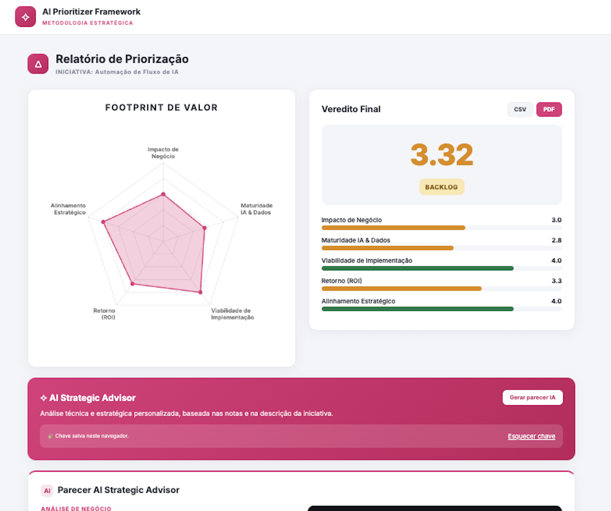
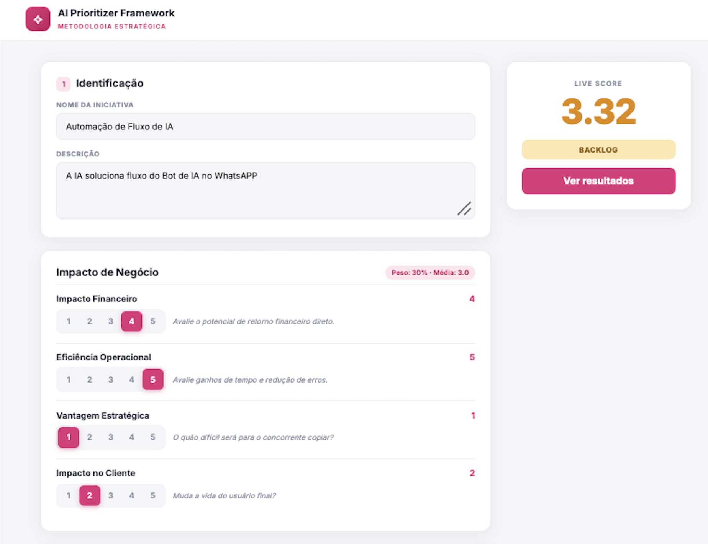
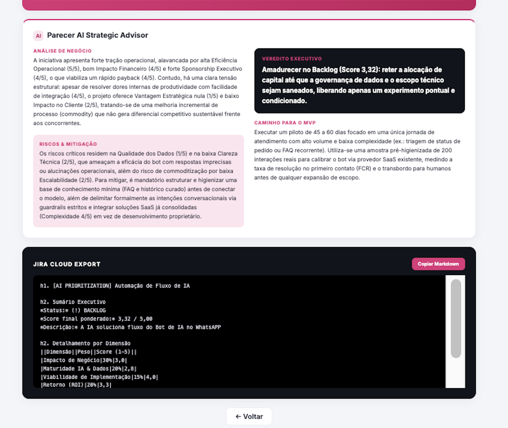

# AI Opportunity Prioritizer ˚✧₊⁎

<p>
  <a href="https://jmartellet.github.io/prioritizer-framework/"></a>
  <a href="docs/diario.md"></a>
</p>

<a href="#english">🇺🇸 English</a> · <a href="#portugues">🇧🇷 Português</a>



---

<a name="portugues"></a>
## 🇧🇷 Sobre o projeto

**Como decidir o que priorizar?** Quem trabalha com IA, dados ou tecnologia conhece bem essa dor: muitas ideias, recursos limitados e uma pressão constante por gerar impacto real.

O AI Opportunity Prioritizer é um framework de priorização que nasceu de uma dor minha. Com ele, avalio cada iniciativa em critérios técnicos e de negócio e recebo um **score de priorização** automático, um relatório visual e um parecer estratégico gerado por IA.

### ✨ O que ele faz

- **Avaliação guiada:** 17 critérios em 5 dimensões, cada um com nota de 1 a 5 e uma dica do que avaliar.
- **Score ao vivo:** a nota ponderada e o veredito mudam a cada clique.
- **Relatório visual:** radar "Footprint de Valor" e barras por dimensão, que mostram *onde* está a força e o risco de cada projeto.
- **Exportações:** CSV para Excel, PDF para a liderança e um texto pronto para colar no **Jira**.
- **AI Strategic Advisor:** um parecer do Gemini com análise de negócio, riscos e mitigação, veredito executivo e caminho para o MVP.

### 📐 Metodologia

| Dimensão | Peso | Critérios |
|---|---|---|
| Impacto de Negócio | 30% | Impacto financeiro, eficiência operacional, vantagem estratégica, impacto no cliente |
| Maturidade IA & Dados | 20% | Qualidade dos dados, complexidade do modelo, infraestrutura, clareza técnica |
| Retorno (ROI) | 20% | Clareza de métricas, escalabilidade, horizonte de payback |
| Viabilidade de Implementação | 15% | Time-to-value, custo total, risco técnico e operacional, integração processual |
| Alinhamento Estratégico | 15% | Alinhamento com OKRs, sponsorship executivo |

1. **Média da dimensão:** média simples dos critérios.
2. **Score final:** soma de cada média × o peso da dimensão.
3. **Veredito:** score **acima de 3,5** → ✅ *Candidato à execução*. Igual ou abaixo → 🟡 *Backlog*.

O raciocínio por trás dos pesos e do corte está no [diário de construção](docs/diario.md).



### 🤖 Como usar o AI Strategic Advisor



1. Crie uma chave gratuita do Gemini em [aistudio.google.com/apikey](https://aistudio.google.com/apikey).
2. No app, abra os resultados, cole a chave no card do Advisor e clique em **Salvar**.
3. Clique em **Gerar parecer IA**.

🔒 **Segurança:** não existe nenhuma chave no código deste repositório. Cada pessoa usa a própria chave, que fica salva só no navegador dela e vai direto para o Google.

### 🛠️ Tecnologias

- **HTML, CSS e JavaScript puros**, sem frameworks nem etapa de build
- [**Chart.js**](https://www.chartjs.org/) para o gráfico de radar
- [**Gemini API**](https://ai.google.dev/) (`gemini-3.8-flash`) para o parecer estratégico
- **GitHub Pages** para a publicação

### 🗂️ Estrutura

```
├── index.html        a página (avaliação e resultados)
├── css/style.css     o visual (rosa porque não sou obrigada 💅)
├── js/
│   ├── criteria.js   a metodologia: dimensões, pesos, critérios e corte
│   ├── app.js        o formulário e os cálculos do score
│   ├── results.js    o relatório: radar, barras e veredito
│   ├── export.js     CSV, PDF e Jira
│   └── advisor.js    o parecer com IA (Gemini)
└── docs/diario.md    o diário de construção, etapa por etapa
```

Para ajustar a metodologia (pesos, critérios ou o corte), basta editar o `js/criteria.js`.

---

<a name="english"></a>
## 🇺🇸 About

**How do you decide what to prioritize?** Anyone working with AI, data or technology knows the pain: too many ideas, limited resources and constant pressure to deliver real impact.

AI Opportunity Prioritizer is a prioritization framework born from my own day-to-day needs. It scores each initiative on business and technical criteria and returns an automatic **priority score**, a visual report and an AI-generated strategic review.

### ✨ Features

- **Guided assessment:** 17 criteria across 5 weighted dimensions, each scored from 1 to 5.
- **Live score:** the weighted score and verdict update on every click.
- **Visual report:** a "Value Footprint" radar chart and per-dimension bars.
- **Exports:** CSV for Excel, PDF for leadership, and Jira-ready markup.
- **AI Strategic Advisor:** a Gemini-powered review covering business analysis, risks and mitigation, an executive verdict and an MVP path.

### 📐 Methodology

Business Impact (30%), AI & Data Maturity (20%), ROI (20%), Implementation Feasibility (15%) and Strategic Alignment (15%). The final score is the weighted average of each dimension's mean. A score **above 3.5** is a *candidate for execution*; anything else goes to the *backlog*.

### 🤖 AI Advisor

Bring your own free Gemini API key ([aistudio.google.com/apikey](https://aistudio.google.com/apikey)). The key is stored only in your browser and sent directly to Google. No key is stored in this repository.

### 🛠️ Built with

Plain HTML, CSS and JavaScript · Chart.js · Gemini API · GitHub Pages

The full build log (in Portuguese), with the reasoning behind each decision, is in [`docs/diario.md`](docs/diario.md).

---

<p align="center">
  Feito por <b>Juliana Martellet</b> · Digital Analytics & Applied AI<br>
  <a href="https://www.linkedin.com/in/julianamartellet/">LinkedIn</a> · <a href="https://github.com/jmartellet">GitHub</a>
</p>
